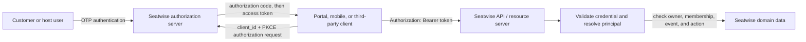
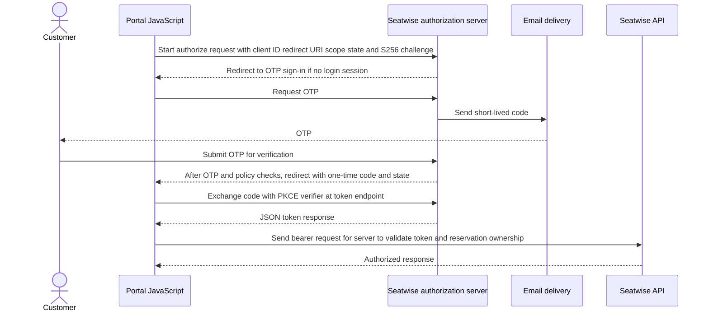
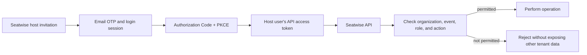

# Seatwise authentication and authorization

> **Status:** Proposed implementation design. Customer OTP sign-in, OAuth endpoints and tokens, reservation-management authorization, host authorization, and payment-provider authentication are not implemented. Keep this document aligned with the code as those pieces are built.

## Design contract

Seatwise exposes one API to the portal, mobile apps, and third-party clients. The portal is a first-party **public OAuth client**: its JavaScript uses Authorization Code with PKCE (`S256`) and has no client secret. Customer and host users authenticate with Seatwise; OAuth issues a client-facing API access token for the authenticated principal.



| Piece | Seatwise responsibility |
| --- | --- |
| Customer or host authentication | Verify a person with a short-lived, single-use email OTP. An authorization-server browser session may remember the verified person; it is not an API credential. |
| OAuth authorization server | Identify the registered client, validate redirect URI, `state`, PKCE, and requested scopes; issue and revoke access tokens. It may be Doorkeeper inside Rails or a selected identity platform. There must be one issuer for Seatwise API access tokens. |
| OAuth client | Request permission to call the API. A browser or native app is a public client; `client_id` identifies it but does not authenticate it or act as a secret. PKCE binds code redemption to the client instance that began the flow. |
| API / resource server | Accept the access token, resolve the authenticated principal, and apply Seatwise authorization to the requested resource and action. |
| Domain authorization | Check reservation ownership for customers and organization/event membership plus role for hosts. Scopes can limit action types; they do not replace these checks. |

OAuth is the protocol for getting an API credential to a client. **JWT is an optional format for the access-token value.** The OAuth token response is JSON either way. A refresh token is a separate credential and policy; JWT does not determine when refresh happens. Do not send an OIDC ID token as the API access token.

## Human access flows

### Customer

1. A guest may browse events and create a reservation hold with an email address without signing in. Seatwise finds or creates the customer record and associates the reservation with it.
2. The hold response includes a checkout capability restricted to that reservation. It permits checkout-status reads and payment start for the hold; it does not grant customer account access.
3. After booking, the customer follows the management link and requests an OTP if there is no active Seatwise login session. Verifying the OTP establishes the authenticated customer principal.
4. The portal starts Authorization Code with PKCE. Seatwise returns a one-time code to the registered portal redirect URI. The portal exchanges it with the PKCE verifier and receives an access token.
5. The portal calls protected `/api/v1` endpoints using the access token. The API resolves the principal and checks that the customer owns the reservation.



The initial account can be created at guest checkout; this design does not require a password setup. OTP issue and verification must avoid account enumeration, store code digests, expire and consume codes once, limit attempts, and rate-limit requests. Login-session, access-token, checkout-capability, and reservation-hold lifetimes are separate.

### Host user

Host users authenticate through the same OTP and OAuth flow. Their access is determined by Seatwise host organization and event memberships, role, and requested action. A host client cannot grant itself access by sending a host or event identifier. The API verifies membership for the target resource on every protected operation.



An individual host's token represents that person. A future server-to-server host integration would use its own host-scoped service principal and client-credentials grant; such credentials never go into browser or mobile code. Host invitations, recovery, organization administration, and the permission matrix remain to be designed.

## API credential contract

### Transport

Protected API calls use the HTTP authorization header over HTTPS:

```http
Authorization: Bearer <access_token>
```

Do not put access tokens in URLs, query parameters, analytics, or logs. Token responses use `Cache-Control: no-store` and `Pragma: no-cache`. The portal keeps an access token in memory and does not persist it in `localStorage`. A bearer credential works by possession, so it must have bounded permissions and lifetime and be protected from disclosure.

### Token response and representation

The OAuth token endpoint returns a JSON envelope such as:

```json
{
  "access_token": "<opaque-token-or-jwt>",
  "token_type": "Bearer",
  "expires_in": 600,
  "scope": "reservations:read reservations:cancel"
}
```

The access-token value can be opaque or a signed JWT. Both forms represent the authenticated principal to the API; neither form alone grants access to every resource associated with a submitted email.

| Format | Fit for Seatwise | Tradeoff |
| --- | --- | --- |
| Opaque random token | Recommended starting point while the Rails authorization server and API share token storage. The API looks up the token and its principal, expiry, and scopes. | Enables straightforward revocation and keeps claims out of the client-visible token, at the cost of a storage lookup or introspection call. |
| Signed JWT access token | Consider if independently deployed API services need to validate tokens locally. The issuer signs; services verify with the issuer's public key set. | Requires key custody/rotation and strict issuer, audience, expiry, and algorithm validation. Revocation normally takes effect at expiry unless shared revocation state is checked. |

OAuth/API client decoupling does not require JWT. If Seatwise later adopts JWT, the minimum validation contract is an allowlisted `iss`, Seatwise API `aud`, stable `sub`, `iat`, and short `exp`; a `scope` claim may further constrain actions. Avoid unnecessary personal data in claims. Use a signing key ID (`kid`) and published public keys for rotation. Do not use a shared signing secret across services when asymmetric signing is available.

Customer and host are domain relationships, not OAuth client types. A `sub` must map to a stable Seatwise principal; host access must still be checked against organization/event membership. A person may act as both customer and host. The identity/principal table shape is open, while reservation ownership remains `Reservation.customer_id`.

Suggested scopes are coarse action limits such as `reservations:read`, `reservations:cancel`, or a future host action scope. API object-level checks remain mandatory. Return `401` for missing/invalid credentials; use non-disclosing `404` behavior when a reservation exists but is not visible to the caller, consistent with the [API contract](api.md#conflicts-and-retries).

### Renewal and logout

Set access-token lifetime and renewal policy before implementation. The browser can request a new authorization code through a top-level redirect, reusing the Seatwise login session where it remains active. If native clients later need refresh tokens, rotate them, detect reuse, and support per-client revocation. Logout ends the Seatwise login session and revokes credentials where supported. Short-lived JWTs otherwise remain valid until expiry unless the API checks revocation state.

## Other credential types

| Credential | Purpose | Must not grant |
| --- | --- | --- |
| Checkout capability | Read checkout state and start payment for one reservation. Use high-entropy opaque value; store only a verifier if persisted. | Customer account access, other reservations, ticket download, or host actions. |
| Customer/host OAuth access token | Call protected Seatwise API routes as the authenticated principal. | Rights beyond token policy and Seatwise domain authorization. |
| Payment-provider authentication | Submit payment notifications. Validate provider signature/credential and payment-to-reservation association. | Customer or host API access. |
| Admission ticket | Offline admission verification. | API access or account management. See [tickets](tickets.md). |

## Implementation alignment

Current portal JavaScript fetches public event data from `/api/v1/events`; that path does not need an end-user token. The API's protected reservation, customer, and host operations remain future work. Keep the auth flow in the API client seam: public reads work without a token; protected requests attach `Authorization: Bearer`; no caller-provided customer ID or email substitutes for the authenticated principal.

If Seatwise issues tokens in Rails, the bounded first slice is:

1. Choose the issuer and principal mapping. The current candidates are Seatwise + Doorkeeper + OTP, or one managed OAuth/OIDC provider. Do not implement both issuers.
2. Register the portal as a public client with exact redirect URIs; allow Authorization Code, require PKCE `S256`, and do not provision a browser secret. Keep dynamic client registration and host machine grants out of the first slice.
3. Connect authorization to OTP-backed Seatwise login. A Doorkeeper provider still needs Seatwise's OTP and resource-owner integration; it is not itself the user authentication system.
4. Protect one customer reservation lookup using bearer authentication plus `customer_id` ownership. Then add cancellation and the corresponding host membership checks.
5. Align `docs/api.md`, routes, models, and error behavior with the implemented token and authorization contract as each slice lands.

## Decisions still open

- Token issuer: Doorkeeper with Seatwise OTP, or a managed provider that supports the customer and host lifecycle.
- Token representation: opaque for the initial Rails service is recommended; JWT is an option if independent resource servers need local validation.
- Stable principal model and how a human identity links to the existing `Customer` record and future host memberships.
- Token lifetime, renewal, logout/revocation guarantees, initial scope names, and host permission matrix.
- OTP delivery provider, code lifetime/attempt policy, account recovery, email changes, and support-assisted identity linking.
- Host invitation/onboarding and any future host service-account grant.

## References

- [V1 API](api.md)
- [Entities and customer ownership](entities.md#customer-identity-and-reservation-ownership)
- [OAuth 2.0 Authorization Framework](https://www.rfc-editor.org/rfc/rfc6749.html)
- [Proof Key for Code Exchange (PKCE)](https://www.rfc-editor.org/rfc/rfc7636.html)
- [Bearer Token Usage](https://www.rfc-editor.org/rfc/rfc6750.html)
