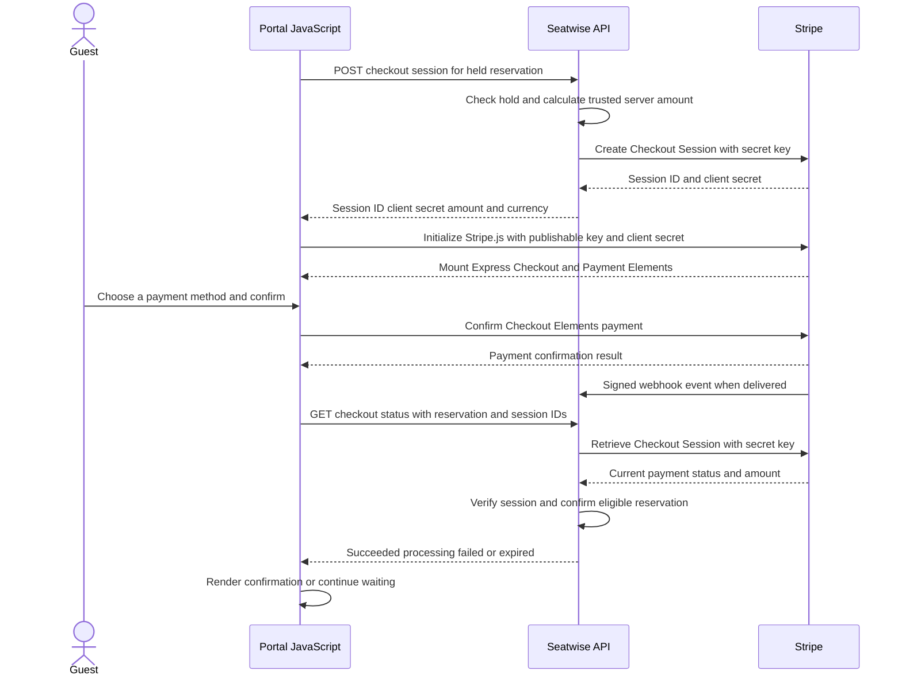

# Payments

## Development Stripe configuration

Local development reads Stripe settings from the Rails development credentials in
`config/credentials/development.yml.enc` under the `stripe` key. The development
credential values are already provisioned locally. Rails selects credentials
based on `RAILS_ENV`; the default credentials file is not merged into the
development file.

The payment provider resolver also accepts these environment-variable
overrides, which take precedence over credentials:

| Environment variable | Credential key | Default |
| --- | --- | --- |
| `STRIPE_SECRET_KEY` | `stripe.secret_key` | none |
| `STRIPE_PUBLISHABLE_KEY` | `stripe.publishable_key` | none |
| `STRIPE_WEBHOOK_SECRET` | `stripe.webhook_secret` | none |
| `STRIPE_DEVELOPMENT_CURRENCY` | `stripe.currency` | `cad` |

The secret and publishable API keys must be Stripe test-mode keys beginning
with `sk_test_` and `pk_test_`. Invalid or missing API keys disable checkout.
The webhook signing secret is optional until webhook verification is configured.
Currency must be a three-letter code. Each event stores its own positive
`ticket_price_cents`; checkout uses that value for every seat in the event.
Existing events are backfilled to 1000 cents.

Compose passes through optional overrides from the shell environment. For
example, `STRIPE_SECRET_KEY` can override the development credential while
Rails continues to run in its selected environment. This supports a shared
production-mode test deployment with sandbox Stripe keys injected by its
infrastructure. `RAILS_MASTER_KEY` only decrypts the credential file selected
by `RAILS_ENV`; it does not select a credential environment.

Keep secret API and webhook keys out of source control, browser responses,
logs, and chat. Only the publishable key may be sent to the browser. Store
deployment overrides in the deployment's secret manager rather than in
repository files.

## Local webhook forwarding

Install and authenticate the Stripe CLI, then start forwarding Stripe test
events to the Rails endpoint:

```sh
stripe listen --forward-to http://localhost:3000/api/v1/payment_webhooks/stripe
```

The CLI prints a temporary `whsec_...` signing secret. Add that value to the
development credentials as `stripe.webhook_secret` with
`bin/rails credentials:edit --environment development`, or set
`STRIPE_WEBHOOK_SECRET` in the Rails process environment. Keep it in the local
encrypted credentials or a secret manager; do not put the printed value in
source control or chat. Restart Rails after changing credentials or
environment variables.

The webhook endpoint verifies the `Stripe-Signature` header and handles
Checkout Session completion and asynchronous success/failure events. The
portal also retrieves the matching Checkout Session on return, so local
checkout reconciliation can still be exercised when webhook forwarding is
not running. A return URL alone never confirms a reservation.

## Checkout behavior and retrying

The development organization endpoint provides the public Stripe key to the
portal. Rails creates or reuses a Checkout Session in Elements mode and
returns the session client secret for Stripe.js. Checkout uses Stripe's
Express Checkout Element and Payment Element; raw card data stays inside
Stripe Elements. A payment remains pending until a signed webhook or a
server-side session retrieval confirms it.

If provider setup fails, the portal leaves the five-minute hold visible and
offers a payment-setup retry. A retry reuses the same pending session for that
reservation. If the hold expires, the guest must choose seats and place a new
hold before attempting payment again.

### Checkout Session and Express Checkout flow



The browser's Stripe confirmation response is not the booking decision. The
portal displays a waiting state and asks Seatwise for checkout status. Seatwise
reconciles Stripe's session (and may also receive its signed webhook), checks
that the session matches the local payment and reservation, and confirms only a
paid session for a hold that is still eligible. The session ID in the return
URL selects what to check; it does not prove payment.

### Ticket price source

**Pricing decision:** ticket price is event data, not Stripe-provider
configuration. Each event has one positive integer `ticket_price_cents` for
every seat in that event. Checkout calculates the total from the reservation's
seat count; the development Stripe configuration still supplies the currency.
Row-level prices can be added as attributes in the event's frozen
`layout_snapshot` if the product needs them; they do not require relational row
tables.
